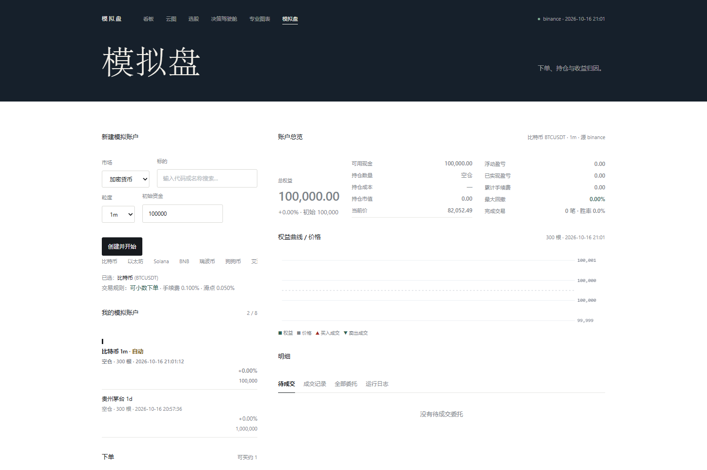
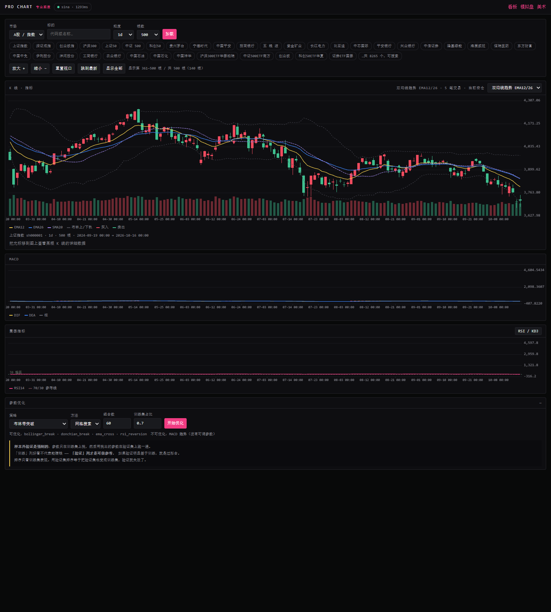

# Quant Workbench · A 股量化工作台

> 一个人用的 A 股量化工作台：**全市场选股 → AI 复核 → 模拟盘验证收益**。
> 零第三方前端依赖，一个 Node 进程 + 一个 Python 解释器（只用 numpy）。

---

## 这是什么

一套能在本地跑起来的 A 股量化工具。核心链路：

```
全市场 5500+ 只
   ↓  L1 快照 + 硬性条件（3 秒，剔除 ST/停牌/低流动性/估值异常）
约 280 只
   ↓  L2 横截面因子排名（6 因子加权 + 行业分散配额）
Top 30
   ↓  L3 拉历史算 27 个技术指标 + AI 复核
最终 picks（8 只）
   ↓
模拟盘等权建仓 → 每天刷新价格 → 跟上证指数比超额
```

**设计原则：先把简单策略做对，再谈复杂。** 等权、不调仓、成本计入 ——
如果这样都跑不赢指数，选股逻辑就有问题，不该用加权和调仓去掩盖。

---

## 能做什么

### 选股（三层漏斗）


- **4 个策略**：双低价值、趋势质量、超跌反转、放量突破
- **硬性条件在前、技术指标在后** —— 硬条件全用基本面字段（可审计），
  技术指标对参数敏感，只用于最后一层
- **行业分散**：申万一级 31 类真实映射（覆盖率 99.7%），同名行业最多 2 只
- **AI 复核**：只对 Top 30 做深度分析，AI 只能从候选池里挑，**不能凭空推荐**

### 市场云图


按**行业分组**、按**市值**决定面积、按**涨跌幅**上色。
一眼看出今天钱在往哪个板块流，而不是逐个看板块指数。

### 决策驾驶舱


把「为什么是这个结论」拆开给你看：
6 个因子各自贡献多少分、风控闸门在哪一步拦截、
**什么情况下结论会变**（换算成「因子需要再涨几档」）。

### 模拟盘 + AI 组合



- **单标的模拟盘**：手动下单 / 自动交易，T+1、整手、手续费滑点全算
- **AI 组合**：等权买入选出的股票、不调仓、每天刷新，跟上证指数比超额

### 专业图表



多标的叠加、十字光标、缩放平移、参数优化（网格/随机搜索 + 样本外验证）。

### 回测

15 列指标：总收益、基准、超额、年化、回撤、夏普、索提诺、卡玛、交易次数、
胜率、盈亏比、期望/笔、成本、持仓比例。**样本不足时明确标「样本不足」，不编数字。**

---

## 快速开始

### 需要什么

- **Node 20+**
- **Python 3.10+ 且带 numpy**（唯一第三方依赖，只在 Python 侧）

### 启动

```bash
node quant/server.mjs
# 打开 http://127.0.0.1:4400/
```

Windows 上双击 `量化看板.cmd` 也行。

可选环境变量：

| 变量 | 作用 | 默认 |
|---|---|---|
| `QUANT_PORT` | 服务端口 | 4400 |
| `QUANT_PYTHON` | 指定 Python 解释器 | 自动探测 |
| `QUANT_TTL` | 行情缓存毫秒 | 20000 |
| `QUANT_OFFLINE` | 置 1 时禁用所有联网（测试用） | — |

### 用 AI 选股

需要在页面上配 API Key（见 [AI配置说明](docs/AI配置说明.md)）。
**不配也能用** —— 会自动降级成本地规则打分，页面上标 `本地打分`。

---

## 项目结构

```
quant/
  server.mjs            HTTP 服务 + 所有 API 路由
  screener.py           三层漏斗：快照、硬条件、因子排名、行业分散
  stock_ai.py           L3 技术指标富化 + AI 复核
  ai_portfolio.py       多标的模拟盘组合
  heatmap.py            市场云图数据（行业分组 + 市值权重）
  datasource.py         行情（新浪 / Binance）
  symbols.py            标的列表 + 缓存
  indicators.py         技术指标
  strategy.py           择时策略
  backtest.py           回测引擎
  decision.py           决策因子分解
  paper_live.py         单标的模拟盘
  autotrader.py         自动交易
  optimizer.py          参数优化
  snapshot_archive.py   每日行情快照（为将来回测攒数据）
  ai_settings.py        AI 配置存储
  web/                  前端（零依赖，无构建步骤）
  tests/                测试套件（自带极小框架，不依赖 pytest）
tools/                  统一测试入口、页面验证、能力清单
docs/                   文档
```

**前端没有任何构建步骤**：`quant/web/*.html` 直接跑，`theme.css` 是共享设计系统。
改 CSS 刷新即生效。

---

## 验证

```bash
node tools/run-tests.mjs --offline      # 全部离线套件
node tools/run-tests.mjs                # 含联网套件（失败不阻塞）
node tools/run-tests.mjs --strict       # 联网套件失败也算失败
```

当前基线（本机实测）：

| | |
|---|---|
| Python 测试 | **1479 断言 / 322 用例**，约 1 秒 |
| 页面 | 6 个页面 0 JS 报错 |
| 运行时 | Node 标准库 + numpy，无其它依赖 |

---

## 数据源

| 数据 | 来源 | 说明 |
|---|---|---|
| A 股全市场快照 | 新浪 `Market_Center.getHQNodeData` | 19 字段含 PE/PB/市值/换手率 |
| 申万一级行业 | 新浪 `getHQNodes` | 31 类，覆盖率 99.7%，缓存 7 天 |
| 个股历史 K 线 | 新浪 | — |
| 加密货币 | Binance 镜像 | — |

**东财（push2 / push2his）实测被按 IP 封禁**，代码里刻意不用。

---

## 几个踩过的坑

1. **全市场逐只拉历史 = 23.6 分钟** → 必须分层。快照接口 2.9 秒，
   所以 L1 只吃快照，L3 才对 Top 30 拉历史。
2. **双低策略前 15 只有 10 只银行**（银行天然 PE 4~7、PB 0.3~0.8）
   → 买 10 只银行和买 1 只风险一样，等于没分散。加行业配额后 3 → 11 个行业。
3. **名称猜行业只有 ~50% 覆盖**，「放量突破」前 30 只里 21 只归进「其它」
   → 换成申万一级真实映射，其它 0 只。
4. **分散度罚分公式少了个 +1** → 第 3 只银行罚分 0，配额形同失效。
5. **符号缓存 TTL 12 小时** → 过期后阻塞枚举 70 秒 → 页面卡死。
   改 7 天 + 过期先用旧数据。

---

## 还没做的

诚实列出来：

- **历史回测拿不到历史 PE/PB**：接口只能返回当前值，所以价值类策略没法回测过去。
  要从今天开始每天存快照（`snapshot_archive.py --save`）攒数据。
- **AI 选股未经真实 API 验证**：代码路径和校验逻辑有测试覆盖，但实际模型效果未知。
- **AI 组合收益需要时间**：建仓当天只反映成本（约 -0.08%），要跑几周才有意义。
- **没有实盘接口**：只读行情 + 模拟盘，不产生任何真实委托。

---

## 安全边界

- 服务默认只监听 `127.0.0.1`，不要直接暴露到公网。
- 不接券商接口，不会下真实委托。
- API Key 存在本地文件里（`quant/state/`），**该目录不进版本库**。
- 所有行情都是只读请求。

---

## 许可

MIT，见 [LICENSE](LICENSE)。

> 说明：项目早期版本包含 [Kirito14IT/prompt-spider-ui](https://github.com/Kirito14IT/prompt-spider-ui)（MIT）
> 的蜘蛛可视化代码。该部分已在重构中**全部移除**，仓库不再包含上游代码。

---

## 相关文档

- [能用来做什么](docs/能用来做什么.md) —— **实测**能力清单与真实数字
- [界面设计说明](docs/界面设计说明.md) —— 为什么长这样
- [选股说明](docs/选股说明.md) —— 三层漏斗、因子、行业分散
- [量化模块说明](docs/量化模块说明.md) —— 数据源、指标口径、回测实现
- [决策驾驶舱说明](docs/决策驾驶舱说明.md) —— 因子分解与风控闸门
- [模拟盘说明](docs/模拟盘说明.md) —— 下单、风控、API
- [自动交易逻辑说明](docs/自动交易逻辑说明.md) —— 三层结构、打分模型、调参
- [AI配置说明](docs/AI配置说明.md) —— 接哪个模型、怎么配
- [部署到服务器](docs/部署到服务器.md) —— 上线指南
- [本地部署说明](docs/本地部署说明.md) —— 本机跑起来的最小步骤
