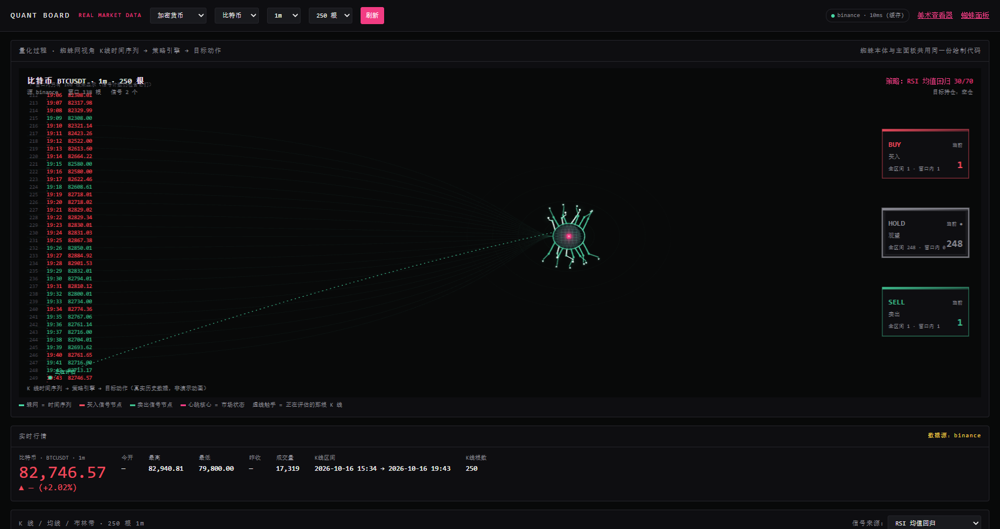
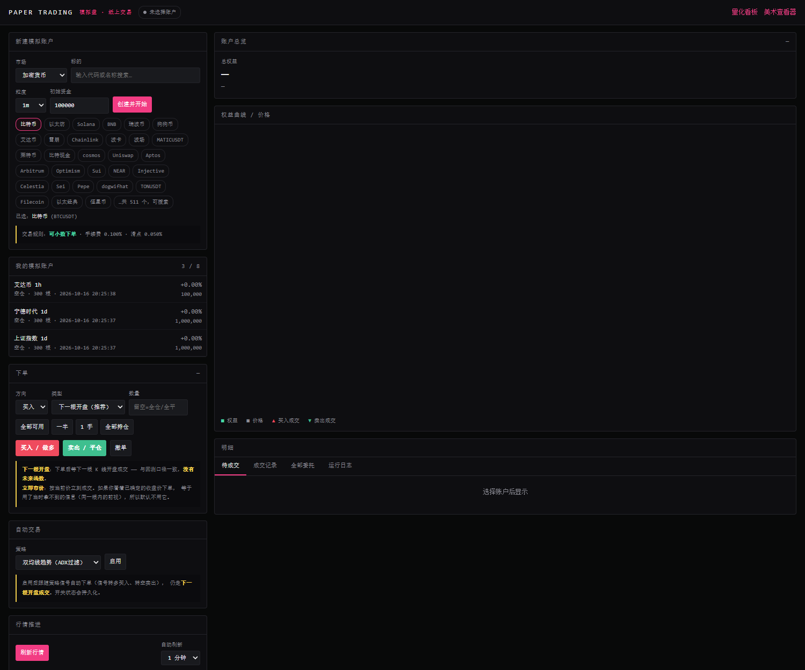
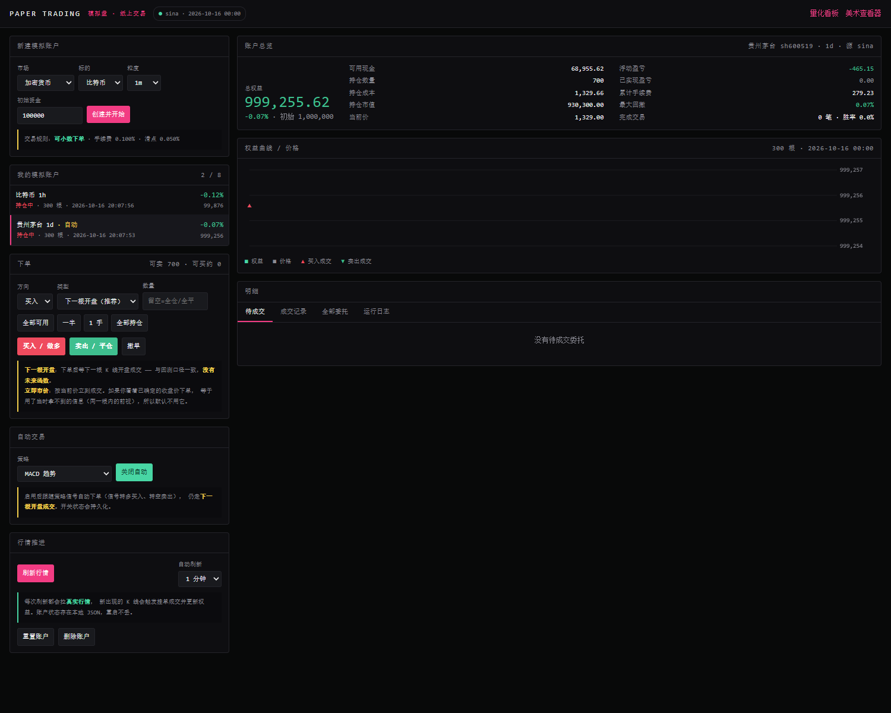
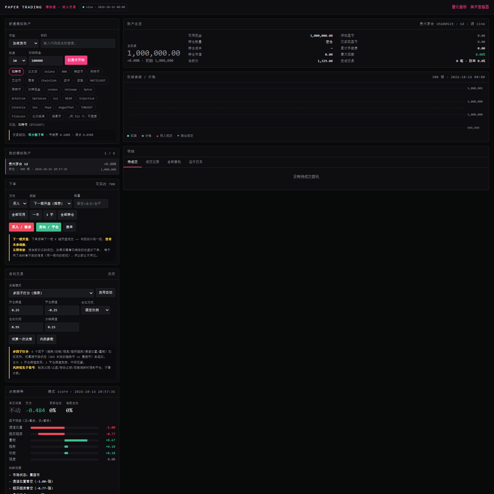
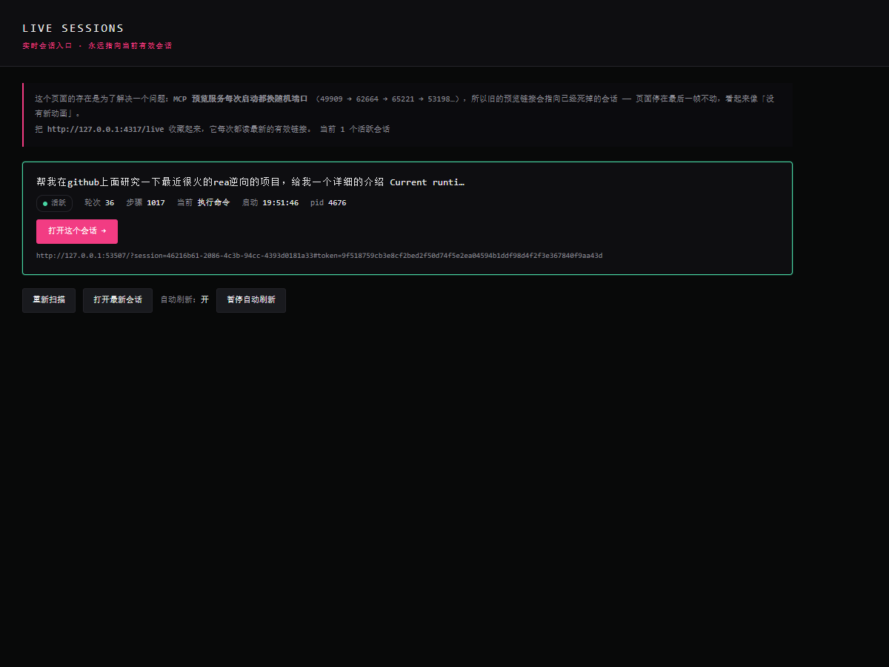

# Quant Spider · 量化蜘蛛

> 我把 [Kirito14IT/prompt-spider-ui](https://github.com/Kirito14IT/prompt-spider-ui) 那个蜘蛛可视化界面，
> 改成了一个我真正会用的东西：**一个跑真实行情、能回测、能模拟盘的量化看板**，
> 顺便把蜘蛛网留下来当过程可视化。

<p align="center">
  <a href="LICENSE"></a>
  
  
  
  
</p>

---

## 这是什么

一开始我只是觉得那个蜘蛛界面挺酷。但看完动画之后我一直在想 —— 它除了好看，还能不能**干点正事**？

所以我把蜘蛛网改成了「**决策过程的可视化**」：每一根 K 线是蛛网上的一行，策略在评估时蜘蛛伸触手过去抓，判断结果分流到 `BUY`、`HOLD`、`SELL` 三条分支。同时旁边配一套正经的 K 线、指标和绩效图表，因为你真要研究策略，光看蜘蛛是不够的。

做完之后我把它自己用了一阵，主要的用途是**验证策略到底行不行** —— 而不是看它画得好看。

<p align="center">
  
</p>

---

## 能做什么

### 真实行情，不是假数据

| 市场 | 数据源 | 标的数 |
|---|---|---|
| 加密货币 | Binance 镜像 → Binance 主站 | 511 个 USDT 对 |
| A 股 / 指数 / ETF | 新浪财经 → 腾讯财经 → 东方财富 | **8265 个** |

A 股这边我是**枚举全量**的：51997 个候选代码，用新浪批量接口跑一遍，98 秒，筛出 8265 个在市标的（含指数、ETF、北交所）。所以你想看宁德时代、上证指数还是某个芯片 ETF，搜中文名就行。

多源自动降级 —— 哪个源挂了自动换下一个，页头会显示实际命中的是哪个。

<p align="center">
  
</p>

### 回测统计

27 个技术指标（Wilder 平滑、布林 ddof=0 这些口径都写了回归测试锁住），5 个经典策略，输出收益率、最大回撤、夏普、索提诺、卡玛、胜率、盈亏比、成本拖累。

两个我特意做进去的东西：

- **强制禁止未来函数**。第 i 根收盘出信号，只能在第 i+1 根**开盘**成交，不提供关闭开关。
- **成本拖累是实测的**，不是估算。零手续费重跑一遍做差，比乘以费率准。

### 模拟盘

可以手动下单、可以开自动交易，账户存在本地 JSON 里，重启不丢。

A 股的真实约束都做了：T+1、100 股整手、涨跌停一字板买不进卖不出。手续费滑点按市场分别配（A 股万三 + 万五，加密千一 + 万五）。

<p align="center">
  
</p>

### 自动交易

这块我返工了三次，因为前两版都是错的。现在是**三层**结构：

```
信号层  6 因子打分，权重随市场状态自适应
  ↓
仓位层  目标仓位比例（0~1），不是 0/1 全仓进出
  ↓
风控层  止损 / 止盈 / 移动止损 / 回撤熔断 / 冷却期
        ★ 优先于信号 —— 触发就执行，不看分数
```

**最关键的一个设计**：6 个因子的权重不是固定的，按 ADX 判定是趋势市还是震荡市，用两套权重。

因为我第一版固定权重，跑出来是这个结果：

```
单边下跌时：
  trend -1.00   strength -1.00              ← 明确看空
  reversion +1.00  position +0.79  momentum +0.83  ← 明确看多
  总分 +0.03 → 判定观望，完全不作为
```

问题在于「超卖」和「布林位置」是**同一个概念的两次计数**（价格一路跌，两个指标必然都指向看多），双倍抵消了趋势信号。而且均值回归只在震荡市成立 —— 单边趋势里"超卖"可以一直超卖，拿它抄底是亏钱的主要方式。

改完之后：

| 市场 | 打分 | 决策 |
|---|---|---|
| 单边上涨 1.2%/根 | +0.694 | 买入 95% |
| 单边下跌 1.2%/根 | −0.700 | 空仓 |
| 震荡市 | +0.089 | 观望 |

界面上有个「**试算一次决策**」按钮，不改行情不下单，先看它会怎么判断：

<p align="center">
  
</p>

### Agent 实时面板

原项目的蜘蛛界面能接 MCP，让 Agent 把自己的执行过程实时画出来。这个我留着并且修了一个坑：

**MCP 预览服务每次启动都随机分配端口**（49909 → 62664 → 65221 → …），所以旧的预览链接会指向已经死掉的会话 —— 页面停在最后一帧不动，看起来像"没有新动画"，但其实代码没问题。

现在加了一个稳定入口 `/live`，它读发现文件、自动指向当前有效的会话：

<p align="center">
  
</p>

---

## 快速开始

需要 **Python 3.12+** 和 **Node.js 20+**。

**依赖只有 numpy 一个**：

```bash
pip install numpy          # 唯一需要的第三方包
```

- **Node 侧零依赖** —— 不用 `npm install`（`mcp/` 子包除外，那个走 MCP SDK）
- **Python 侧只用 numpy** —— 指标计算、回测、优化都基于它；没有 pandas、scipy、talib
- 前端是原生 ES module + Canvas，无构建步骤

> 为什么需要 numpy：`indicators.py` / `backtest.py` / `paper.py` / `strategy.py` /
> `pipeline.py` / `autotrader.py` / `optimizer.py` 都在模块顶层 `import numpy`。
> 纯 Python 实现这些指标会慢 30~100 倍，不值得。

```bash
git clone https://github.com/<你的用户名>/<仓库名>.git
cd <仓库名>
```

**量化看板**

```bash
node quant/server.mjs
# 打开 http://127.0.0.1:4400/
```

**蜘蛛 UI（原始演示）**

```bash
npm start
# 打开 http://127.0.0.1:4317/
```

Windows 用户直接双击 `量化看板.cmd` / `启动.cmd` 就行。

> 首次打开量化看板如果选的是 A 股，需要等 **约 98 秒**枚举全量标的（只跑一次，之后缓存 12 小时）。
> 想跳过就先看加密市场，那边 10 秒左右。

**Agent 实时面板**

```bash
node mcp/live-feed.mjs --interval 2.0
# 然后打开 http://127.0.0.1:4317/live
```

---

## 项目结构

```
├── quant/                    ← 我加的部分
│   ├── datasource.py         多源自动降级行情
│   ├── symbols.py            8265 个标的的目录与搜索
│   ├── indicators.py         27 个技术指标
│   ├── strategy.py           5 个策略
│   ├── backtest.py           回测引擎（成本拖累实测）
│   ├── paper.py              离线顺序回放器
│   ├── paper_live.py         交互式模拟盘
│   ├── autotrader.py         三层自动交易逻辑
│   ├── pipeline.py           产出看板 JSON
│   ├── server.mjs            HTTP 层
│   └── web/                  看板与模拟盘前端
│
├── app/                      ← 原项目的蜘蛛渲染
├── mcp/                      ← 原项目的 MCP 服务器（我改过 live-feed）
├── lib/                      ← 共享模块
└── tests/                    ← 原项目的测试
```

---

## 验证

我对这套东西的信任主要来自自检，不是来自"看起来跑通了"。

```bash
python quant/indicators.py    --selftest    # 55 项断言
python quant/backtest.py      --selftest    # 20
python quant/paper.py         --selftest    # 20
python quant/paper_live.py    --selftest    # 62
python quant/autotrader.py    --selftest    # 44
python quant/datasource.py    --selftest    # 7
python quant/symbols.py       --selftest    # 25
```

**233 项断言，全部通过。**

值得说的是这些断言抓出了 **20 个 bug，其中 13 个不报错、只是让结果悄悄算错**。举两个：

- `getattr(ind, "ema12")` 取不到值 —— 指标在 `ind.values` **字典**里而不在属性上，导致所有因子算不出来、打分恒为 0。表面上"运行正常"，实际完全没在工作。
- `meta=` 参数无条件传给 `AutoDecider`，抛 `TypeError` 被 `except` 吞掉 —— **自动交易显示"运行中"但永远不下单**，日志里只有一行不起眼的"决策失败"。

这类问题看代码基本发现不了，只能靠测试。

---

## 几个我踩过的坑（写下来免得你再踩）

**1. 别用绝对百分比归一化技术指标。**
我最初写「EMA 差 / 价格 > 2%」当趋势满分线。结果每天涨 1.2% 的稳定上涨序列算出来是"不买" —— 因为 EMA12 和 EMA26 只差 1.2%。加密一天动 5%、指数一天动 0.5%，同一个阈值必然一头失灵。改成除以 ATR 就自动适配了。

**2. MACD 柱不能当方向用。**
柱 = DIF − DEA，衡量的是"加速度"。指数衰减序列里它**必然是正的** —— 越跌基数越小，跌幅绝对值在缩小，短期均线反而比长期均线"跌得少"。结果一个正在崩盘的标的显示"动能看多 +0.83"。要用 DIF。

**3. 东方财富的「列表」和「K线」是不同域名。**
`push2` 和 `push2his`。我开发期间用它的列表接口取 A 股全量（78ms 返回 5923 只，很快），过了几分钟整个 IP 就被封了 —— 四个主机、三种请求头、http/https 全部 `RemoteDisconnected`。所以"东财能用"和"东财被封"可以同时成立，得按具体端点判断。现在 A 股全走新浪。

**4. 高频截图会攒出几十 MB 垃圾。**
用 headless Chrome 验证界面时，`--user-data-dir` 会在项目里留下 27 MB 的 profile 目录。记得加进 `.gitignore`。

---

## 还没做的

诚实列一下，免得你以为是完整方案：

- **图表没有交互** —— 没有十字光标、没有 tooltip、X 轴没有日期刻度。这是目前最大的短板，看盘体验差不少。
- **只能做多** —— 没有做空，没有组合层面的仓位管理。
- **没有参数优化** —— 阈值和权重是我手工设的，没跑网格搜索。
- **AI 决策模式没实测** —— 接口、兜底、输出夹紧逻辑都验证了，但我这边没有可用的模型端点，所以没真跑过模型。想用得自己配（见下）。
- **数据源脆弱** —— 东财已经被封过，新浪也可能。降级链能顶一阵，全挂了就得换。
- **单机单用户** —— 状态是本地明文 JSON，没有并发控制。

### AI 决策模式怎么接

`autotrader.py` 里的 `AIDecider` 是可插拔的，接任意 OpenAI 兼容端点：

```bash
export QTRADER_AI_URL="http://127.0.0.1:11434/v1/chat/completions"   # Ollama
export QTRADER_AI_MODEL="qwen2.5:14b"

# 或者任意命令行程序：stdin 收 JSON，stdout 回 JSON
export QTRADER_AI_CMD="python my_agent.py"
```

然后在界面上把模式选「外部 AI 决策」。

**AI 的输出只被当作建议**：风控在本地独立判定，止损止盈熔断不问模型；AI 给的仓位会被夹到上限内（实测给它 `target: 5.0` 会被夹到 `0.6`）；返回乱码降级为 hold；调用失败自动回落到内置打分逻辑。**一个胡说的模型不能把账户打爆。**

---

## 安全边界

这是模拟盘，**不是实盘系统**：

- 只读行情，代码里**没有任何交易接口的接入**
- 不持有 API Key，**没有下单能力**
- 不产生任何真实委托
- 所有成交只发生在内存和本地 JSON 文件里

---

## 来源与许可

基于 **[Kirito14IT/prompt-spider-ui](https://github.com/Kirito14IT/prompt-spider-ui)**（MIT）。

| 部分 | 来源 |
|---|---|
| 蜘蛛 UI、Canvas 渲染、MCP 服务器、原有测试 | **原项目**，版权归 **Kirito14IT** |
| `quant/` 全目录（数据源 / 指标 / 策略 / 回测 / 模拟盘 / 自动交易 / 看板） | 我写的 |
| `app/spider.js`、`app/live-renderer.js`、`mcp/live-feed.mjs`、`server.mjs` | 在原项目上改的 |

原项目的蜘蛛动画做得很好，我这个仓库只是在它上面加了一层量化。想看纯蜘蛛效果请去上游。

`LICENSE` 保持原样未改（MIT，Copyright © 2026 Kirito14IT）—— MIT 允许修改和再分发，但要求保留原始版权声明，这一条我照做了。

我自己新增的部分同样以 MIT 发布。

---

## 相关文档

- [量化模块说明](量化模块说明.md) —— 数据源、指标口径、回测实现
- [模拟盘说明](模拟盘说明.md) —— 下单、风控、API
- [自动交易逻辑说明](自动交易逻辑说明.md) —— 三层结构、打分模型、调参
- [本地部署说明](本地部署说明.md)
- [MCP 接入使用说明](MCP接入使用说明.md) —— 让 Agent 用蜘蛛展示执行过程
- [实时跟随即时面板说明](实时跟随即时面板说明.md)
- [美术与演示过程说明](美术与演示过程说明.md)
