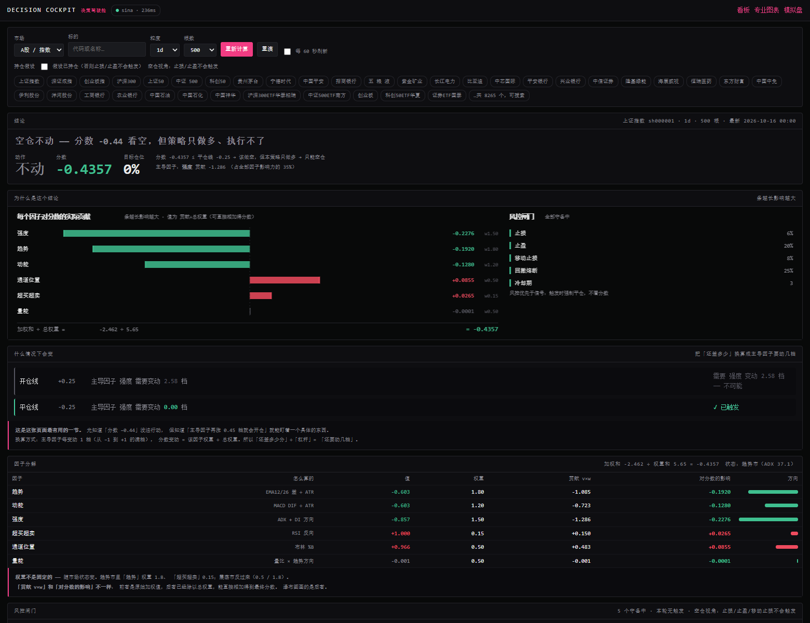
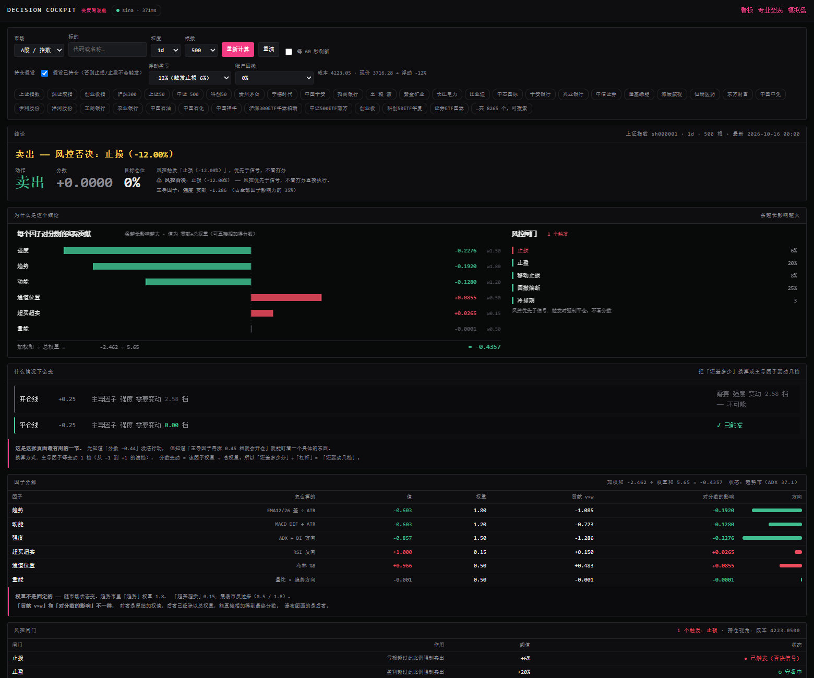

# 决策驾驶舱 —— 把量化过程画出来

`/decision.html`



---

## 为什么要重做

原来的蜘蛛动画画的是「K 线时间流 + 信号点飞向分支」，而**蜘蛛本体匀速乱飘** ——
`body.vx = 26` 是硬编码常量，`drawSpiderBody` 只读它、从不根据数据修改。
换句话说：数据层是真的，蜘蛛是装饰的。

问题在于**隐喻用错了**：

> K 线不是网，**因子才是**。

量化流程本身就是一张网：

```
6 个因子 ──加权求和──> 分数 ──阈值──> 动作 ──风控闸门──> 仓位
   ↑                    ↑                        ↑
 网上的丝            蜘蛛的位置              蜘蛛能不能过去
```

所以新画法让**每个视觉元素都承载真实数据**。

---

## 每种视觉元素编码什么

| 元素 | 表达 | 数据来源 |
|---|---|---|
| **丝的粗细** | 该因子的**权重**（随市场状态变） | `regime_weights()` |
| **丝的颜色** | **方向**：红=看多 / 绿=看空 / 灰=中性 | `factors[k]` 符号 |
| **丝上光点** | **贡献值 v×w**，位置与亮度都编码它 | 实测可达 ±1.4 |
| **丝的弯曲** | **绝对强度 \|v\|**，强信号绷直、弱信号下垂 | `abs(value)` |
| **丝末端标签** | 因子名 + 值 + 权重 | 直接标注 |
| **蜘蛛径向位置** | **分数 −1~+1** 映射到中心↔边缘 | `score` |
| **蜘蛛朝向** | 当前动作（BUY 上 / SELL 下 / HOLD 右） | `action` |
| **蜘蛛亮度** | **把握度** = \|分数\| ÷ 开仓阈值 | `margin` |
| **顶部张力弧** | **离阈值还差多少**，弧闭合就该动手 | `entry_threshold` |
| **风控闸门** | 六个锁，蜘蛛想冲过去被拦住 | `RiskConfig` + `riskHit` |
| **撞击光环** | 风控正在拦截 | `risk_hit` 非空 |

---

## 最有价值的一帧：风控拦截



这一帧能同时看到三件互相矛盾的事：

1. **因子说买** —— 超买超卖 +1.00、通道位置 +0.97，都是看多
2. **信号说卖** —— 加权总分 −0.44，倾向做空
3. **实际卖出** —— 但**不是**因为信号，而是因为 `风控触发：止损（-12.00%）`

画面上的表现：蜘蛛被推向 SELL 方向，旁边的「止损」闸门红框高亮标着
`● 已触发（拦截）`，通往决策区的连线变成**红虚线**（被阻断），
蜘蛛周围有撞击光环。

**「信号想动、风控不让」这个矛盾，纯文字日志很难一眼看懂。**

---

## 怎么看到风控拦截

默认是**空仓视角** —— 而止损/止盈/移动止损**只在有仓位时才可能触发**，
空仓时它们无事可做。所以默认状态永远看不到拦截。

要看到就看：

1. 勾上「**假设已持仓**」
2. 选一个亏损档位（如 `−12%（触发止损 6%）`）

页面会自动反推成本价：要表达「亏 12%」，成本 = 现价 ÷ 0.88。

> ⚠️ 这里踩过一个坑：第一版直接拿现价当成本，算出来的浮亏是 0%，
> 风控当然不触发 —— 页面上表现为「选了 −12% 但没拦截」。
> 必须**从浮动盈亏反推成本**，不能把亏损比例当成本用。

---

## 为什么能"重演计算过程"

量化是**确定性**的：同样的 K 线 + 同样的参数 → 同样的因子与分数。
所以动画不是随机装饰，而是把一次**真实计算**的分层结果按顺序演出来：

| 阶段 | 画面 |
|---|---|
| 1 | 读取 K 线 |
| 2 | 算 27 个指标 |
| 3 | 判定市场状态（决定权重） |
| 4 | 计算 6 个因子 —— 丝依次亮起 |
| 5 | 按状态加权 —— 光点沿丝滑向中枢 |
| 6 | 归一化打分 —— 中枢累积、张力弧收紧 |
| 7 | 比阈值 |
| 8 | 过风控 —— 撞闸门 / 放行 |
| 9 | 定仓位 |

每次重演都**准确复现上面的数字**，因为数据本来就是算出来的，
动画只是把中间结果按顺序显示。

点「**重演计算过程**」可以再看一遍。

---

## 数据契约

后端：`quant/decision.py`（56 项自检）+ `GET /api/decision`

```
GET /api/decision?market=ashare&symbol=sh600519&interval=1d&limit=500
                  &position=1&entry=4223.05&peak=4476.43&drawdown=0.28
```

| 参数 | 说明 |
|---|---|
| `market` / `symbol` / `interval` / `limit` | 行情（同上其他页面） |
| `position` | 仓位比例。**>0 时才会评估止损/止盈**，默认 0（空仓） |
| `entry` | 持仓成本价 |
| `peak` | 持仓期间最高价（移动止损用） |
| `drawdown` | 账户回撤比例（`0.28` = 28%） |
| `halted` | `1` 表示已熔断，只允许离场 |

返回结构：

```json
{
  "meta":     { "name", "symbol", "interval", "source", "bars", "at", "close" },
  "regime":   { "name", "adx", "weights", "weightSets" },
  "factors":  [ { "key", "label", "desc", "value", "weight", "contrib", "dir" } ],
  "score":    { "raw", "clamped", "totalWeight" },
  "gates":    { "entry", "exit", "action", "margin" },
  "risk":     [ { "key", "label", "desc", "value", "active", "fired" } ],
  "decision": { "action", "target", "score", "reasons", "riskHit", "mode" },
  "stages":   [ { "id", "label", "detail", "value" } ],
  "assumption": { "position", "entryPrice", "drawdown", "note" }
}
```

前端：`quant/web/decision-cockpit.js`（`DecisionWeb` 类）+ `quant/web/decision.html`

**为什么新写而不是改旧的**：老渲染器 `spider-web.js` 保持可用，可以对照。
两者的隐喻根本不同 —— 老的画时间流，新的画因子网。

---

## 和「决策解释」卡片的分工

模拟盘页面里的「决策解释」卡片**已经有**因子条形图了。所以蛛网不该重复它。

分工是：

| | 决策解释卡片（条形图） | 决策驾驶舱 |
|---|---|---|
| 回答 | **每个因子是多少** | **谁在真正推动决策** |
| 形式 | 排序后的裸值 | 权重与值同屏，形状即结论 |
| 优势 | 精确读数 | 一眼看出分歧还是共振 |

举个实测例子：

```
条形图看到的：  强度 0.81 最大  →  以为强度最重要
蛛网看到的：    趋势丝最粗(w=1.8)，贡献 +1.36 才是最大项
```

**强度因子裸值最大（0.81），但趋势的贡献更大（+1.361 vs +1.216）**，
因为它权重更高。这个「谁在主导」只有把权重和值放同屏才看得出来。

而且蛛网的**形状本身就是信号** —— 六根丝都朝外 = 一致看多；
三三分裂 = 分歧。条形图要一行行读，蛛网一眼就看出来。

---

## 已知局限

- **一屏只能看一个时点** —— 蛛网画的是"此刻会怎么决策"，不是时间序列。
  想看历史演化得看 K 线图或模拟盘的事件日志。
- **持仓假设是手工设的** —— 不会自动读模拟盘的真实持仓。
  想联动需要再加一层（把 `/api/paper/:id` 的状态传进来）。
- **重演动画是固定 9 阶段** —— 不反映真实计算耗时。
  真实耗时在顶部状态行（`sina · 455ms`）。
- **`spider-web.js` 那个旧画法还在** —— 目前挂在量化看板（`/`）上。
  新画法在独立页面，没有替换它。要不要换掉是个产品决定，
  我倾向保留两套：旧的时间流对"看信号分布"仍然有用。
