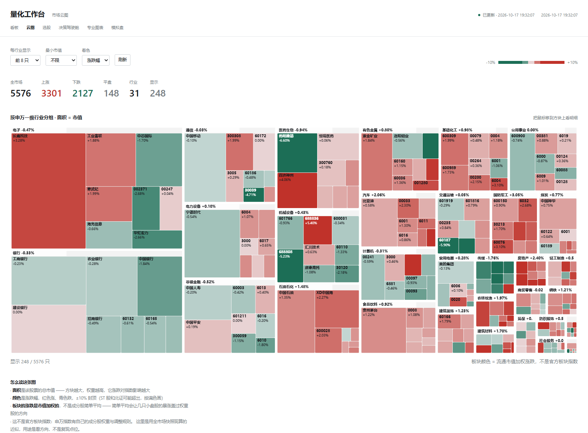

# 市场云图说明



按**申万一级行业**分组、按**市值**决定面积、按**涨跌幅**上色。
一眼看出今天钱在往哪个板块流 —— 而不是逐个去翻板块指数。

---

## 一、为什么做这个

看板块轮动，传统做法是翻一页页板块涨幅榜。问题是：

- **涨幅榜只给百分比，不给你「这个板块有多大」**。一个 500 亿的小板块涨 3%，
  和一个 20 万亿的板块涨 0.5%，对市场的意义完全不同。
- **看不到内部分化**。板块整体 +1%，可能是权重股涨 5% 拖着，也可能是
  300 只小票普涨 —— 这两种情况的操作含义相反。

云图把这两件事一起解决：**面积 = 市值权重，颜色 = 涨跌，细分到个股**。
所以你能一眼看出「电子板块整体 -0.47%，但主要是谁在拖」。

---

## 二、怎么读

| 视觉 | 编码 | 说明 |
|---|---|---|
| **板块矩形** | 申万一级行业 | 31 类，覆盖率 99.7%（5560/5576） |
| **矩形面积** | 总市值 | 板块面积 = 板块总市值；个股面积 = 个股总市值 |
| **颜色** | 涨跌幅 | 红涨青跌，±4% 视觉饱和（数据本身不截断） |
| **板块标题** | 名称 + 市值加权涨跌 | 例：`电子 -0.47%` |
| **格子里的字** | 名称（够宽）或代码 | 太小的格子不写字，避免糊成一团 |

### 为什么用幂曲线着色

A 股大多数个股日内涨跌在 ±3% 以内。线性映射（±10% 满色）会让整张图接近灰白 ——
这在第一版实测出现过：银行板块整体 -0.33%，所有格子几乎一个色，看不出差别。

现在用 `(|pct| / 4) ^ 0.7` 再映射：

| 涨跌 | 视觉强度 |
|---|---|
| 0.2% | 能看出方向 |
| 1% | 明显 |
| 3% | 基本饱和 |
| 4%+ | 满色 |

**这是视觉增强，不是数据变换** —— 鼠标悬停看到的数字始终是原始值。

---

## 三、板块涨跌怎么算

用**流通市值加权**，不是简单平均。

```
简单平均：10 只小盘股各涨 5%，1 只万亿权重股跌 1% → 显示 +4.5%，方向反了
市值加权：那只权重股决定方向 → 更接近真实指数
```

权重优先用**流通市值**（`nmc`）而不是总市值：涨跌幅是「可交易部分」的价格变化，
用总市值加权会把大量不流通的股权算进去（比如国企大股东持股）。

### ⚠️ 这不是官方板块指数

申万行业指数有自己的成分股权重和定期调整规则。这里是**用全市场快照现算的近似**，
用途是看方向，不是复现指数点位。

---

## 四、和选股的区别

两者用**同一份快照**（`screener.fetch_market`），但用途不同：

| | 选股 | 云图 |
|---|---|---|
| 是否剔除 ST/停牌/低流动性 | **要剔** | **不能剔** |
| 目的 | 找可买的标的 | 看全市场分布 |

云图如果剔掉停牌股和亏损股，板块的市值权重和涨跌就是错的 ——
一块市值 2000 亿的停牌权重股被剔除，整个板块的加权涨跌会失真。

---

## 五、接口与 CLI

### API

```
GET /api/heatmap?top=8&minCap=30&refresh=1
```

| 参数 | 说明 | 默认 |
|---|---|---|
| `top` | 每个行业最多显示多少只（0 = 全部） | 0 |
| `minCap` | 只保留总市值 ≥N 亿的股票 | 0 |
| `refresh` | 置 1 强制刷新（跳过 60 秒缓存） | — |

返回结构：

```json
{
  "asOf": "2026-10-17 19:32:07",
  "clampPct": 10,
  "total": 5576,
  "shown": 248,
  "breadth": { "advance": 3301, "decline": 2127, "flat": 148 },
  "sectors": [
    {
      "name": "电子", "chg": -0.47, "count": 8, "mktcapYi": 198327.63,
      "stocks": [
        { "symbol": "sz000725", "code": "000725", "name": "京东方A",
          "price": 4.31, "chg": -1.14, "mktcapYi": 1614.2,
          "floatCapYi": 1582.0, "pe": 18.6, "turnover": 1.2,
          "st": false, "suspended": false }
      ]
    }
  ]
}
```

**全市场拉取要 3-5 秒**，所以服务端缓存 60 秒。

### CLI

```bash
python quant/heatmap.py --text                 # 终端里看行业排行
python quant/heatmap.py --json --top 8         # 输出 JSON
python quant/heatmap.py --json --min-cap 100   # 只看 100 亿以上
python quant/heatmap.py --selftest             # 离线自检（10 断言）
```

---

## 六、已知限制

1. **盘中数据是延迟的**：新浪快照接口有分钟级延迟，不是逐笔行情。
2. **行业映射缓存 7 天**：新股或行业调整会滞后，但影响面很小（覆盖率 99.7%）。
3. **停牌股保留、颜色为灰**：它占面积但不参与涨跌统计。
4. **「其它」行业**：拿不到映射的股票会归到「其它」，实测在真实数据里是 0 只
   （离线模式没有映射表时才可能出现）。
5. **没有概念云图**：SayuStock 有概念板块（白酒、半导体…），我们只有申万一级行业。
   概念板块需要另一套成分股映射，目前数据源里没有。

---

## 七、参考

这个功能的思路来自 [SayuStock](https://github.com/KimigaiiWuyi/SayuStock)（GPL-3.0）
的「大盘云图 / 行业云图 / 概念云图」。实现是独立写的（本项目 MIT），
没有复制它的代码：

- 它用 `plotly` + `playwright` 渲染成图片发到聊天平台（Bot 场景）
- 我们在浏览器里用原生 Canvas + squarified treemap 实时画，零依赖
