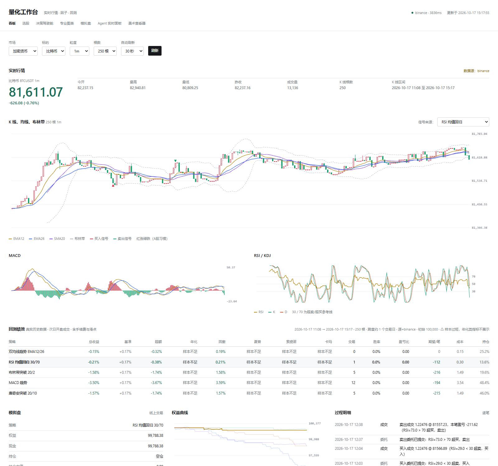

# 界面设计说明 —— 为什么长这样



如果你只想看「怎么用」，看 [README](../README.md)。这篇讲的是**为什么这么设计**，
以及哪些做法是**刻意避免**的。

---

## 一、设计方向：行情底稿

这个工具的性质决定了它的视觉：**数字、真钱、每天看**。
所以设计上唯一的奢侈是「清晰的层级」和「对齐的数字」，其余一律让位。

概念上是**一张行情底稿**：连续的纸面，靠留白和字号分层，不靠边框切块。

### 三个「不用什么」

**1. 不用卡片**

圆角白卡 + 同一档阴影，是把任何内容都装进去的默认做法。它的问题不是丑，
是**把所有内容压成同一个层级** —— 页面上十个区块看起来一样重要。

这里所有内容都在**同一张纸上**。分组靠间距（36px）和字号对比，不靠边框。
区块的标题比正文只大 0.5px，但比正文重 —— 层级由字重和留白承担。

**2. 线只在表格里**

表格的行分隔线**编码信息**（一行是一条记录），该有。
区块之间的横线只是装饰，去掉，用留白代替。

**3. 红绿是唯一的饱和色**

朱红 `#C0322A`（涨）和深青 `#1C6E56`（跌）是这个行业约定，也是全站仅有的彩色。
链接用墨色加下划线，焦点用墨色描边 —— 不再引入第三种颜色。

这样视线只会被「涨了/跌了」吸引，这正是我们想要的。

---

## 二、刻意规避的 AI 生成痕迹

第一版（改版前）几乎全中。这些不是「丑」，是**看起来像模板**：

| 痕迹 | 改版前 | 现在 |
|---|---|---|
| 统一圆角卡片 + 同一阴影 | 每页都是 | 无卡片，靠留白分组 |
| 全大写字母间距标题 | `STOCK SCREENER` | 中文标题，正常字距 |
| 中点连接的元信息 | `A · B · C` 到处是 | 逗号或分行 |
| 箭头后缀链接 | `选股 →` | 链接就是链接 |
| 等宽字体做小标签 | 全站 Consolas | 只有 canvas 里的数字用 tabular |
| 浅灰底小卡片堆指标 | `.metric` 是独立盒子 | 一条线 + 一组读数 |

**等宽字体全站铺开**是最明显的一处。它让人觉得「这是程序员做的东西」，
但它同时**降低了中文的阅读舒适度** —— 等宽字体的中文回退字体通常很难看。
现在正文用系统无衬线，数字用 `tabular-nums` 保证列对齐。

---

## 三、字体与数字

- **一个家族**：系统无衬线（苹方 / 微软雅黑 / Noto Sans SC）
- **数字等宽**：`font-variant-numeric: tabular-nums` —— 表格能读的前提
- **不加载网络字体**：这个工具在本地跑，多一个网络依赖就多一个离线打不开的理由

字号阶梯（`--fs-*` 变量）：

| 用途 | 字号 | 例子 |
|---|---|---|
| 最重要的数字 | 42px | 现价、结论 |
| 次级数字 | 26px | 涨跌额、指标值 |
| 页面标题 | 19px | 「量化工作台」 |
| 区块标题 | 13px | 「实时行情」 |
| 正文 / 表格 | 13px / 11.5px | |
| 标签 | 11px | 「今开」「最高」 |

**标题和标签拉开 3 倍**，靠对比分层 —— 不需要装饰。

中文标题用**正常字距**。给中文加 `letter-spacing` 是英文排版的习惯，
用在中文上会让字与字之间散开，读起来更慢。

---

## 四、页面结构

```
┌──────────────────────────────────────────────────────────┐
│ 量化工作台   实时行情 · 因子 · 回测         ● 状态  时间   │  ← 报头
├──────────────────────────────────────────────────────────┤
│ 看板  选股  决策驾驶舱  专业图表  模拟盘  Agent  美术        │  ← 导航（细线收口）
├──────────────────────────────────────────────────────────┤
│                                                          │
│  [控件行]                                                 │
│                                                          │
│  实时行情                                 数据源：sina    │  ← 区块标题
│  ┌──────────┬─────────────────────────────────────────┐  │
│  │ 81,652   │ 今开 82,150  最高 82,940  最低 80,809   │  │  ← 报价：价格独占一栏
│  │ -498     │ 昨收 82,150  成交量 13,152  K线根数 250  │  │
│  └──────────┴─────────────────────────────────────────┘  │
│                                                          │
│  K 线、均线、布林带                    250 根 1m          │
│  [图表]                                                   │
│                                                          │
└──────────────────────────────────────────────────────────┘
```

**报头每页一致**：左边产品名 + 当前页面，右边日期和市场状态。
下面一条细线收口，然后就是内容 —— 不做大标题横幅。

**控件放在内容区的第一行**，不塞进报头。它们是「这一页的参数」，
不是「全局导航」。

---

## 五、各页的取舍

### 看板 `/`

价格是主角 —— 它回答「现在多少钱」，所以给最大字号。
涨跌额紧贴在下面（它们是一件事的两个面），
OHLC 排成网格在右侧。

⚠️ 第一版把**涨跌额设得比价格还大**，层级反了：眼睛先看到 -504，
再去找 81652 是什么。

### 选股 `/screen.html`

四个策略不再是四张卡片，而是**一行四个带下划线的选项**。
卡片会让「选一个」变成「看四块内容」，而下划线说的是「这四个里选一个」。

漏斗 `5576 → 281 → 30` 用三个大数字排成一句，
数字之间用竖线分隔 —— 这确实是一个**序列**（逐级筛选），
所以用结构表达顺序是合理的。

### 决策驾驶舱 `/decision.html`

一句话结论用 26px 加粗，是全页最先读到的。下面才是分数和依据。

「什么情况下会变」这一节用左侧色条表示状态：
绿=已达成、黄=可达、灰=不可能。**不画进度条** ——
「还差 2.58 档」这种数字本身就说清楚了，画条反而失真。

### 模拟盘 `/paper.html`

两栏：左边是**操作**（建仓、下单、自动交易），右边是**结果**（总览、曲线、明细）。
鼠标从左往右是一次完整的操作路径。

买卖按钮是**全站唯一用底色区分的控件** —— 方向必须一眼分清，
这是安全相关的例外。

### 专业图表 `/pro.html`

图表占绝对主导，控件压成两行。
所有和看图无关的说明都退到区块底部的小字。

---

## 六、实现方式

### 共享设计系统 `quant/web/theme.css`

改版前 5 个页面各自内联 ~470 行 CSS，**同一套变量写五遍**。
现在抽成一个文件，五个页面都引用它，只在各自 `<style>` 里保留页面专属规则。

好处：改一处颜色，五页同步。

### ⚠️ 保留老类名

`.card`、`.pos`、`.neg`、`.metric`、`.sess` 这些类名**一个都没改**，
虽然它们描述的是旧设计（`.card` 现在根本不是卡片）。

原因：各页的 JS 会动态生成这些 class，重命名要同步改 JS，
风险大于收益。**名称是历史包袱，视觉是当下的。**

### canvas 配色必须和 CSS 对齐

`decision-cockpit.js` 和 `chart.js` 里的颜色是 JS 常量，
改 `theme.css` 时要同步改它们 —— 否则画布和页面是两套语言。

`decision-cockpit.js` 的 `const C` 里已经写了这条注释。

---

## 七、无障碍与响应式

这些是**底线，不是加分项**：

- **键盘可达**：`:focus-visible` 用墨色 2px 描边
- **减少动效**：`@media (prefers-reduced-motion: reduce)` 把动画压到 0.01ms
- **对比度**：正文墨色 `#16181C` 在白底上约 17:1；次要文字 `#737A82` 约 4.8:1
- **窄屏**：1080px 断点两栏变单栏，720px 断点缩小字号和边距
- **表格横向滚动**：手机上不拆行，用 `.tablewrap` 横向滚动

---

## 八、还没做的

诚实列出来：

1. **没做深色模式** —— 用户明确要亮色。要做的话得再加一套 token
2. **没做打印样式** —— 如果需要「把选股结果打印出来」，要单独写 `@media print`
3. **图表内部排版没完全重做** —— `chart.js` 只换了字体和配色，
   坐标轴刻度的疏密逻辑没动
4. **没有一个页面的「空状态」被单独设计** —— 现在复用说明文字，
   比如模拟盘的「选择账户后显示」
5. **只在一台机器上验证过** —— Windows + Chrome。字体回退在
   macOS / Linux 上会不同（用系统字体就是这个代价）
