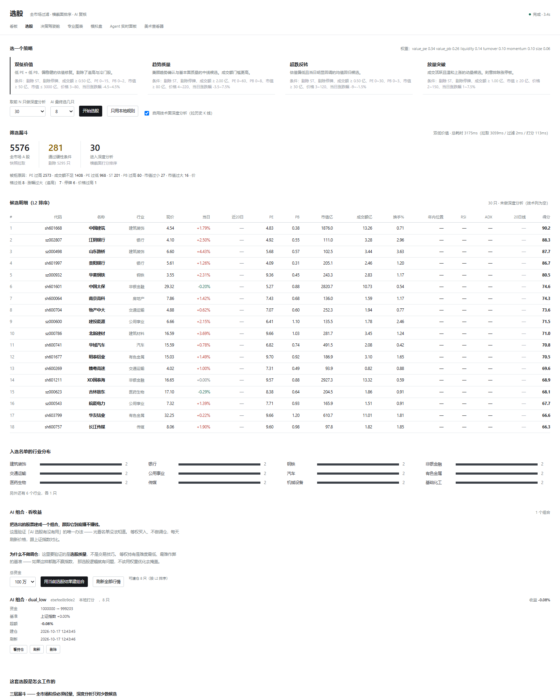
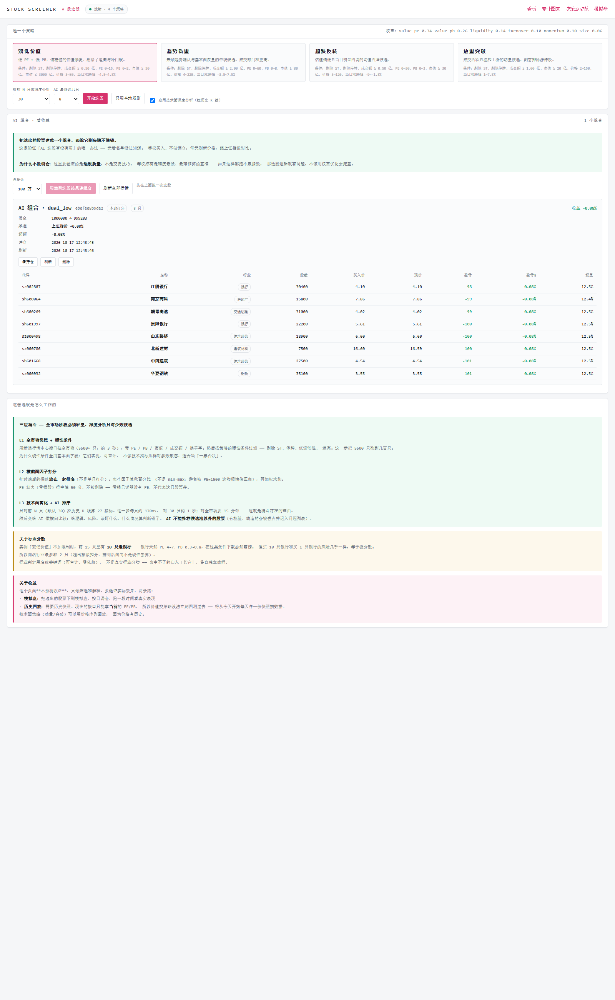

# 选股说明 —— 三层漏斗，以及为什么不能对全市场跑重逻辑



选股结果 + AI 组合（等权建仓、每个持仓的盈亏与权重）：



页面：`http://127.0.0.1:4400/screen.html`

---

## 一、先说清楚：这个项目原来没有选股

原来所有模块都是**择时** —— 对**单个**标的说「现在该不该买」：

| 模块 | 实际做什么 |
|---|---|
| `strategy.py` 5 个策略 | 单标的持仓判断 |
| `autotrader.py` 6 因子打分 | 单标的决策 |
| `symbols.py` | 标的目录（搜索/名字查询） |
| `optimizer.py` 的 rank | 排**参数组合**，不是排股票 |

**没有一个能回答「8000 只里买哪几只」。** 选股（横截面）和择时（时间序列）是两个不同的问题，不能互相替代。

---

## 二、三层漏斗

```
L1  全市场快照 → 硬性条件过滤        2.9 秒    5576 → 281 只
L2  横截面因子打分 → 排序            ~0.1 秒   纯计算
L3  对 Top N 拉历史算指标 → AI 排序   ~1 秒    30 只 × 170ms
```

### 为什么必须分层

不是「设计得优雅」，是**被数据源吞吐逼出来的**：

| 做法 | 耗时 | 结论 |
|---|---|---|
| 对全市场逐只拉历史 K 线 | 8265 × 171ms = **23.6 分钟** | ❌ 不可行 |
| L1 用全市场快照 | **2.9 秒** | ✅ 可行 |
| L3 只对 30 只拉历史 | **1 秒** | ✅ 可行 |

参考项目 [AlphaSift](https://github.com/ZhuLinsen/alphasift) 的工程结论也是这个：

> 全市场阶段必须轻量、快速、可回退；单股深度分析只适合最终少量候选。

---

## 三、L1：数据源

用的是**新浪行情中心**接口：

```
https://vip.stock.finance.sina.com.cn/quotes_service/api/json_v2.php/
  Market_Center.getHQNodeData?page=1&num=100&node=sh_a
```

**19 个字段，选股需要的一切都在**（实测可用率）：

| 字段 | 含义 | 可用率 |
|---|---|---|
| `name` | 名称（能判 ST） | 100% |
| `trade` / `settlement` | 现价 / 昨收 | 100% |
| `changepercent` | 涨跌幅 | 100% |
| `amount` | 成交额 | 99.8% |
| `turnoverratio` | 换手率 | 99.8% |
| `per` | PE | **73.6%** |
| `pb` | PB | 98.9% |
| `mktcap` / `nmc` | 总市值 / 流通市值 | 100% |

### ⚠️ PE 为空 = 亏损股，不是数据缺失

这是最容易搞错的语义。所以：

- 策略**要求** PE 时（`pe_min`/`pe_max` 有值）→ 亏损股被刷掉
- 策略**不要求** PE 时（都是 `None`）→ 亏损股放行

「放量突破」策略故意不限制 PE —— 成长股常常亏损。

### 每个板块有多少只（实测）

| 板块 | 只数 | 页数 |
|---|---|---|
| `sh_a` 沪市 A 股 | 2319 | 24 |
| `sz_a` 深市 A 股 | 2906 | 30 |
| `hs_bjs` 北交所 | 351 | 4 |
| **合计** | **5576** | **58** |

单次请求上限 **100 条**（`num=500` 也只回 100），所以必须分页。

### 性能优化过程

| 版本 | 耗时 | 改了什么 |
|---|---|---|
| 初版 | 7.4 秒 | 8 并发 |
| 现在 | **2.9 秒** | 12 并发 + 提前停页 |

「提前停页」：某板块某页返回不足 100 条就说明到底了，不再等尾部空页。

### ⚠️ 东财不可用

`push2his.eastmoney.com`（K 线）和 `push2.eastmoney.com`（clist 全市场列表）
实测**都被按 IP 封禁**（`RemoteDisconnected`）。所以本项目不依赖东财。

注意：**列表接口和行情接口是不同域名**，所以「东财能用」和「东财被封」都对 —— 取决于具体端点，别一概而论。

---

## 四、L1：硬性条件

条件全部照搬主流开源选股项目的口径（见 alphasift 的策略 YAML）。

**为什么硬性条件全用基本面/估值字段**：它们客观、可审计，
不像技术指标那样对参数敏感，适合当「一票否决」。

### 四个内置策略

| 策略 | 核心条件 | 权重侧重 |
|---|---|---|
| **双低价值** | PE 0~15、PB 0~2、市值 ≥50亿、成交额 ≥5000万、涨跌幅 ±4.5% | 估值 |
| **趋势质量** | 成交额 ≥2亿、市值 ≥80亿、PE ≤60、涨幅 ≤7.5% | 动量+流动性 |
| **超跌反转** | **当日跌幅 -9%~-1.5%**、PB ≤3、市值 ≥30亿 | 估值+流动性 |
| **放量突破** | **当日涨幅 +1%~+7.5%**（排除涨停）、成交额 ≥1亿、**不限 PE** | 流动性+换手 |

### 共同纪律：不追高

所有策略都有涨跌幅上限。A 股散户追高被套是常见模式，所以
「涨幅过大（追高）」是一个明确的拒绝原因，会显示在漏斗里。

### 「超跌反转」的一个反直觉设计

它的**动量权重是 0**。因为如果动量权重为正，「跌 9%」会比「跌 2%」得分更高
—— 那是**鼓励接飞刀**。跌幅只当过滤条件，不参与打分。

有测试守着这条语义（`test_oversold_reversal_does_not_reward_bigger_drops`）。

---

## 五、L2：横截面因子

**「横截面」= 同一天把全市场放在一起排名。** 这是选股的核心思路：
不是问「这只股票好不好」，而是问「这只比其它 300 只更好吗」。

六个因子（分数统一归一到 0~100 的秩百分比）：

| 因子 | 取值 | 方向 |
|---|---|---|
| PE 低 | `pe` | 越小越好 |
| PB 低 | `pb` | 越小越好 |
| 动量 | `change_pct` | 越大越好 |
| 流动性 | `amount` | 越大越好 |
| 换手活跃 | `turnover` | 越大越好 |
| 市值 | `mktcap` | 越大越好 |

### 为什么用秩百分比，不用 min-max 归一化

**min-max 会被极端值压扁。** 候选池里只要有一个 PE=1500 的股票：

| PE | min-max 得分 | 秩百分比得分 |
|---|---|---|
| 5 | 100.0% | **100** |
| 6 | 99.9% | **80** |
| 1500 | 0% | 0 |

min-max 下 PE=5 和 PE=6 几乎分不出差别，区分度就没了。
秩百分比只关心「排第几」，天然抗极端值。

### 缺失因子得中性 50 分，不是 0 分，也不剔除

给 0 分等于把「亏损股」当成「最差」，但它只是没有 PE 而已。

---

## 六、行业分散 —— 一个实测发现的问题

**不加限制时，「双低价值」选出的前 15 只有 10 只是银行。**

这不是 bug —— 银行天然 PE 4~7、PB 0.3~0.8，在「低 PE + 低 PB」
条件下载必然霸榜。但这样的名单没有实用价值：**买 10 只银行和买 1 只银行
的风险几乎一样，等于没分散。**

### 做法

同名行业最多取 2 只（`max_per_sector=2`）。超出配额的**扣分排到后面**，
而不是硬性丢弃 —— 实在没别的可选时还能选它。

### 效果（同一时点、同一策略）

| | 行业数 | 银行只数 |
|---|---|---|
| 不加限制 | 3 | 10 |
| **加限制** | **11** | **2** |

### ✅ 行业判定：申万一级真实映射（99.7% 覆盖）

**第一版用名称关键词猜行业，覆盖率只有 ~50%，实测不可用**：

> 「放量突破」策略选出的前 30 只里 **21 只被判为「其它」**，
> 而这 21 只实际分属 10 多个完全不同的行业
> （远东股份=电力设备、内蒙一机=国防军工、中科曙光=计算机…）。
> 名称里根本不含行业词，猜不出来。分散度控制等于没生效。

**现在用新浪的申万一级行业节点**：

```
getHQNodes                            → 节点树，含 sw1_* 申万一级
getHQNodeData?node=sw1_110000          → 该行业全部成员
```

| | 名称关键词 | **申万一级（新浪）** |
|---|---|---|
| 覆盖率 | ~50% | **99.7%**（5560/5576） |
| 行业数 | 23（自造） | **31（标准）** |
| 拉取耗时 | 0 | **2.5 秒**（缓存 7 天） |
| 「其它」 | 16~21 只 | **0 只** |

实测效果（top=30）：

```
双低价值      行业 18 个  其它 0 只  罚分 0 只
趋势质量      行业 19 个  其它 0 只  罚分 0 只
超跌反转      行业 18 个  其它 0 只  罚分 0 只
放量突破      行业 19 个  其它 0 只  罚分 0 只
```

31 个行业 × 配额 2 = 62 > 30，所以**永远不会触发兜底补足**。

**退化策略**：缓存没有 + 网络失败时回退到名称关键词（覆盖率低但聊胜于无）。
离线模式（`QUANT_OFFLINE=1`）直接走名称法，保证测试可复现。

---

## 七、L3：技术面富化 + AI 排序

只对前 N 只（默认 30）拉历史 K 线，算 27 指标 + 6 因子 + 5 策略信号。

### AI 做什么、不做什么

参考 AlphaSift 的职责划分：**硬条件由代码执行，软判断由 LLM 执行。**

**AI 做**（规则难覆盖的）：
- 解释因子冲突 —— 估值好但趋势弱、资金强但在追高
- 提炼交易逻辑 —— 归到「低估值修复」「资金热度」等主题
- 识别共同风险 —— 最终名单是不是全押在同一行业/风格
- 输出**可复盘字段** —— `watch`（盯什么）和 `invalidators`（什么情况算判断错了）

**AI 不做**：
- 不做硬性筛选（那是 L1 的活，可审计）
- **不能推荐候选池以外的股票** —— 有校验，编造的代码会被丢弃并记入问题列表

### 校验是安全边界，不是可选项

模型可能编造股票代码（幻觉），也可能推荐「更好的」池外股票。
用户界面会展示这些代码，**不校验就等于把幻觉当事实**。

校验逻辑（见 `stock_ai.py` 的 `validate_picks`）：
1. 归一化代码（接受 `601668` / `sh601668` / `SH601668`）
2. 不在候选池里 → 丢弃 + 记入 `problems`
3. 重复标的去重
4. 名次以清洗后的顺序为准（不听模型的 `rank`）
5. 把握度钳到 0~1

### 没有 API key 时

**不报错、不假装成功。** 走本地规则打分，并标明 `mode: "local"`，
页面上也显示「未配置 AI（AI 设置里填 API key 可启用）」。

本地打分的构成（故意写死，不做调参 —— 它只是兜底，不是研究成果）：
L2 横截面分 60% + 技术面确认 40%（趋势方向、ADX、RSI 过热、20 日涨幅、年内位置）。

---

## 八、AI 组合 —— 让 AI 真的去模拟盘跑，看收益

**这是验证「AI 选股有没有用」的唯一办法。** 光看名单没法知道。

### 怎么用

1. 在选股页跑一次选股（本地规则或 AI 排序都行）
2. 点「用当前选股结果建组合」
3. 组合建好后能看：收益、基准（上证指数）、超额收益、每只持仓盈亏

### 设计要点

| 项 | 做法 | 为什么 |
|---|---|---|
| 资金分配 | **等权** | 按分数/市值加权看起来更聪明，但很容易变成过拟合。等权是难度最低、最难作弊的基准 |
| 调仓 | **不做** | 这里要验证的是**选股质量**，不是交易技巧。如果等权持有都跑不赢指数，选股逻辑就有问题 |
| 成本 | 计入滑点+佣金 | 买入价含 0.05% 滑点、另收 0.03% 佣金，所以**建仓当天收益是负的** |
| 整手 | A 股 100 股整数倍 | 预算买不满一手就不建仓，记入「建仓问题」 |
| 基准 | 上证指数 | 拿不到时明确返回 `null`，不编造 |

### ⚠️ 为什么不复用模拟盘会话

`paper_live.PaperSession` 是**单标的**的（只有一个 `qty`）。而组合是多标的。
硬套要建 N 个会话，还会撞上 `MAX_SESSIONS = 8` 的淘汰逻辑 ——
**组合成员会被静默删掉，收益统计就错了**。

所以单独写了 `quant/ai_portfolio.py`：多标的、独立 state 文件
（`quant/state/ai-portfolios.json`），复用同样的成本模型和行情接口。

### API

```
GET    /api/portfolio/list        列出所有组合（带收益）
POST   /api/portfolio/create      用选股结果建组合
GET    /api/portfolio/:id         组合明细
POST   /api/portfolio/:id/refresh 刷新行情
DELETE /api/portfolio/:id         删除
```

### 诚实说明

- **这个组合不做调仓** —— 买入后一直持有。想验证调仓逻辑用模拟盘（paper.html）
- **收益要时间** —— 建仓当天只反映成本（负收益），要跑一段时间才有意义
- **行业分布用真实申万一级** —— 能看出名单是不是挤在一个行业

---
## 九、⚠️ 关于收益验证 —— 最重要的限制

**选股结果目前没法回测历史收益。**

原因：新浪行情中心接口只能返回**当前**的 PE/PB/市值。
历史估值拿不到（东财被封，其他源也没这数据）。

所以验证只有一条路：**从今天开始每天存一份快照**，攒够时间再回放。

```bash
python quant/snapshot_archive.py --save          # 每天存一次
python quant/snapshot_archive.py --list          # 看存了哪些
python quant/snapshot_archive.py --eval dual_low --days 20   # 回看
```

快照存在 `quant/state/snapshots/YYYY-MM-DD.jsonl`（已被 gitignore）。

- 一份全市场快照约 **1.1 MB**
- 一年 250 个交易日约 **275 MB**
- 提供 `--prune 400` 清理旧文件

**数据不足时会明确说不能评估，不编造结果。** 实测只有一天数据时输出：

> 无法评估：只有 1 天的快照，没法评估。收益验证需要至少两天的数据

### 技术面策略可以用价格序列回放

因为**价格有历史**（K 线接口能拉过去的数据）。
所以动量/突破类策略的历史回测是可行的，价值类不行。

---

## 十、API

| 方法 | 路径 | 说明 |
|---|---|---|
| GET | `/api/screen/strategies` | 列出所有策略（含条件与权重） |
| POST | `/api/screen` | 跑 L1+L2，`{strategy, top}` |
| POST | `/api/screen/ai` | 叠加 L3，`{strategy, top, pick, noAi?, context?}` |
| GET | `/api/portfolio/list` | 列出 AI 组合（带收益） |
| POST | `/api/portfolio/create` | 用选股结果建组合，`{strategy, picks?, capital}` |
| GET | `/api/portfolio/:id` | 组合明细（含每只持仓盈亏） |
| POST | `/api/portfolio/:id/refresh` | 刷新行情 |
| DELETE | `/api/portfolio/:id` | 删除组合 |

结果缓存 60 秒（全市场快照要 3 秒，连点两次不该等两次）。
实测：首次 7.5 秒 → 缓存命中 **2ms**。

---

## 十一、命令行

```bash
python quant/screener.py --list                    # 列策略
python quant/screener.py --strategy dual_low       # 跑选股
python quant/screener.py --all                     # 跑全部（共用一份快照）
python quant/screener.py --selftest                # 自检（离线）

python quant/stock_ai.py --strategy dual_low --no-ai   # 只本地打分
python quant/stock_ai.py --strategy dual_low           # 带 AI 排序

# AI 组合（模拟盘，看收益）
python quant/ai_portfolio.py --create dual_low --top 8 --capital 1000000
python quant/ai_portfolio.py --list                    # 列表 + 收益
python quant/ai_portfolio.py --show <id>               # 明细
python quant/ai_portfolio.py --refresh-all             # 刷新全部行情
```

---

## 十二、诚实的能力边界

| 项 | 状态 |
|---|---|
| L1 全市场快照 | ✅ 实测 5576 只 / 2.9 秒 |
| 硬性条件过滤 | ✅ 4 个策略，条件可审计 |
| L2 横截面因子 | ✅ 6 因子，秩百分比 |
| 行业分散 | ✅ **申万一级真实映射**（99.7% 覆盖），31 行业 |
| L3 技术面富化 | ✅ 30 只 / 1 秒 |
| AI 排序 | ⚠️ **未经真实 API 验证**（本地无 key），代码路径与校验逻辑有测试覆盖 |
| 历史收益回测 | ❌ **做不到** —— 没有历史估值数据，只能从今天攒 |
| 行业精确分类 | ✅ 申万一级（新浪 sw1_*），缓存 7 天 |
| 换手率数据 | ⚠️ 99.8% 可用，缺失的会得中性分 |
| 北交所 | ✅ 351 只已纳入（但流动性普遍差，多数会被成交额门槛刷掉） |

**这个页面不预测收益。** 它做的是筛选和解释。要验证效果，看第八节。
