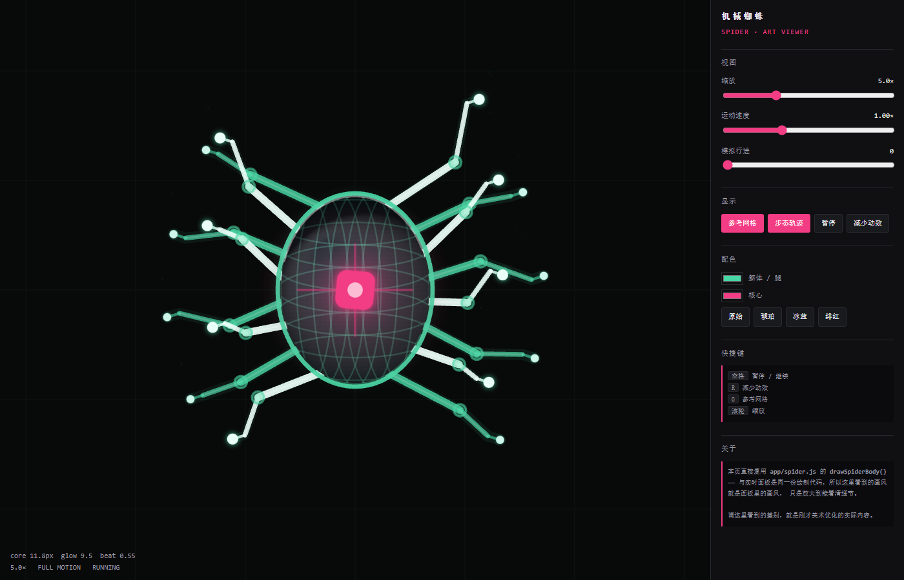

# 美术优化 + 演示过程说明

> 两件事：**让画面更好看**，以及**让页面里看得出 Agent 在干什么**。

---

## 一、页面里看到具体演示过程

### 改动前

画布上「一轮 = 一个点」。一个 turn 平均有 **29.6 次工具调用**（最多 92 次），
所以整场面只有几十个点，看不出过程。

### 改动后：步骤级

**每一个点 = 一次真实的工具调用。**

```
000  抓取网页 · https://mp.weixin.qq.com/s/uRuQVu5jd3EEy0Ku…
001  联网检索 · procedural spider three.js open source gi…
003  执行命令 · Write-Output "=== 本地环境检查 ==="
006  读取文件 · C:\Users\24942\Documents\deepseek-harness\…
019  结束后台任务 · pwsh-10
028  读取图像 · C:\Users\24942\Documents\deepseek-harness\…
```

现在能看见每一次读文件、跑命令、写代码、派子代理。

### 工具名 → 中文动作

| 工具 | 显示 | 摘要取自 |
|---|---|---|
| `read` / `write` / `edit` | 读取 / 写入 / 修改文件 | `file_path` |
| `grep` / `glob` | 搜索内容 / 查找文件 | `pattern` |
| `pwsh` | 执行命令 | `command`（截 96 字） |
| `web_search` / `web_fetch` | 联网检索 / 抓取网页 | `queries` / `url` |
| `job_output` / `job_kill` | 收取 / 结束后台任务 | `job_id` |
| `subagent` / `workflow` | 派出子代理 / 编排工作流 | `description` |
| `ask_user_question` / `exit_plan_mode` | 请求人工确认 / 提交计划待批 | — |

### 实时状态行

面板副标题持续显示**当前正在做什么**：

```
33 轮 · 822 步 · 正在进行「读取图像」
```

这个每 2 秒刷新一次 —— 即使当前步骤没结束，面板也在动。

### 步骤状态

每步有 `pending → running → completed/failed` 四态，从 `tool/result` 推断成败。

---

## 二、美术优化

### 优化前 vs 后

| 部位 | 改动前 | 改动后 |
|---|---|---|
| **腿** | 单层 1px 直线 | **锥形三段**：髋 2.35 / 胫 1.5 / 足尖 0.85，加圆头线帽 |
| | — | **白色高光脊线**，圆管有受光面 |
| | 无关节 | **膝部关节环**（描边+填充） |
| | 2×2 方块足 | **圆形足端 + 辉光**，抬腿时更亮更大 |
| **躯体** | 扁平椭圆，10% 填充 | **三层**：外侧体积渐变 → 内壳径向渐变 → 内壳暗面 |
| | 线框 32% 不透明 | 线框 30%，叠加在暗壳上，立体感更强 |
| | 单色描边 | **金属边缘光**：左上高光弧 + 左下冷色反光 |
| **核心** | 实心方块 | **径向光晕 + 十字光刺 + 白色内核**，脉冲更明显 |
| **网** | 单层极淡贝塞尔 | **纵向渐变底色** + 网丝呼吸位移 |
| | 选中无区分 | 选中事件加 **4.5px 柔光外层** |
| | — | 飞行词条：外光晕 + 实心菱核 + 白色中心 |
| **分支卡** | 平描边 | **顶部渐变条 + 内描边 + 计数辉光**（有值时发光） |

### 实现方式

绘制逻辑**从 `live-renderer.js` 抽到 `spider.js` 的 `drawSpiderBody()`**：

```javascript
export function drawSpiderBody(c, body, time, reducedMotion, theme, opts)
```

**为什么抽出来**：
1. 实时面板和美术查看器**共用同一份代码**，不会画风分叉
2. 本体美术可以独立调、独立看

### 美术查看器 ⭐

打开 **http://127.0.0.1:4317/spider-viewer.html**



因为 Spider 在正常面板里只有约 **50px 高**，美术细节根本看不出来。
查看器把它放大到 **5×**（可调 2–12×），并提供：

| 控件 | 作用 |
|---|---|
| 缩放 | 2× – 12×，滚轮也能调 |
| 运动速度 | 0 – 3× |
| **模拟行进** | 给本体加速，看步态怎么变 |
| 参考网格 | 对齐参考（间距随缩放联动） |
| **步态轨迹** | 记录足端位置，**直接看出落脚点和抬腿弧线** |
| 减少动效 | 对比静态姿态（辅助功能状态） |
| 配色 | 主体色 / 核心色 + 4 套预设（原始 / 琥珀 / 冰蓝 / 绯红） |
| 角标 | 实时显示 core 尺寸、glow、beat 值 |

**关键点**：它 `import { drawSpiderBody } from './spider.js'`，
**和实时面板是同一份代码** —— 所以查看器里看到的画风就是面板里的画风。

---

## 三、改动清单

| 文件 | 改动 |
|---|---|
| `app/spider.js` | **新增** `drawSpiderBody()` + `alphaColor()`（美术优化主体） |
| `app/live-renderer.js` | `spider()` 改为委托调用；`web()` 增强网/词条/分支卡 |
| `app/spider-viewer.html` | **新增** 美术查看器 |
| `server.mjs` | `.html` 加入 MIME 白名单（否则查看器 404） |
| `mcp/live-feed.mjs` | 重写为步骤级（原轮次级备份在 `live-feed.turn-level.mjs.bak`） |

> **注意**：这轮改动**首次修改了原项目源码**（`app/spider.js`、`app/live-renderer.js`、
> `server.mjs`）。之前几轮我都保持零改动，但美术优化必须动渲染代码。
> 三处都是小幅可控改动，原文件也都能从 GitHub 重新拉取还原。

---

## 四、怎么用

**实时看演示过程**（双击或命令行）：
```powershell
node mcp/live-feed.mjs --interval 2.0 --max 200
```

**看美术**：浏览器打开 http://127.0.0.1:4317/spider-viewer.html

**参数**：

| 参数 | 说明 |
|---|---|
| `--max 200` | 画布窗口内最多多少步（默认 180） |
| `--interval 2.0` | 轮询间隔秒 |
| `--session <id>` | 指定会话，默认最近修改的 |
| `--verbose` | 打印 assistant 叙述 |

---

## 五、已知限制

1. **`model` 分支通常很少**
   本会话 822 步里绝大多数是 `code`。这是**真实情况** ——
   我大多自己完成，很少开子代理。分类反映实际，不该为了分布好看去调。

2. **步骤多了会退化成"噪声墙"**
   窗口上限 200 步时，列表会很长。已在 `--max` 提供控制，
   但更好的做法是按 turn 分组折叠（未实现）。

3. **标签偏长**
   命令类摘要截 96 字符，文件路径会占满整行。可以用 `this.label()` 再截。

4. **中文文件名显示**
   面板字体是等宽字体回退，中文能显示但字重偏轻。
